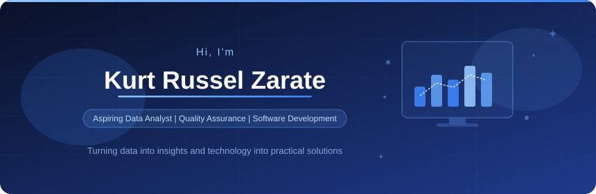

---

### About Me

I'm a fourth-year Bachelor of Science in Information Technology (BSIT) student with interests in Data Analytics, Quality Assurance, and Software Development. I enjoy working with data, evaluating software quality, and developing technology-driven solutions through practical projects.

- Interested in data analysis, statistical methods, and data visualization.
- Experienced in data collection, cleaning, organization, and interpretation.
- Interested in software testing, performance benchmarking, and quality evaluation.
- Experienced in contributing to desktop, mobile, and web application development.
- Exploring AI-assisted tools to support development, research, and analytical workflows.
- Continuously developing my skills in Python, SQL, Tableau and Power BI.
- Email: **krzarate.mstz@gmail.com**

---

### Technical Skills

** Data Analytics & Statistics**

- Microsoft Excel, Google Sheets, Power BI
- Data Collection, Data Cleaning, Exploratory Data Analysis (EDA)
- Statistical Analysis, Data Interpretation, Data Visualization

** Quality Assurance & Software Testing**

- Functional Testing, Software Benchmarking, Test Documentation
- Grafana k6, Firebase Test Lab (Robo Test), Google Lighthouse, ADB

** Programming & Databases**

- HTML, CSS, JavaScript, ReactJS, Electron
- Python, Kotlin, XML, Flutter, Dart
- MySQL, PostgreSQL, Supabase

** Development & Productivity Tools**

- Visual Studio Code, Android Studio, WEKA

** AI-Assisted Tools**

- ChatGPT, Claude, DeepSeek, Gemini

---

### Currently Learning

- Python for Data Analysis
- SQL for Database Querying and Analysis
- Advanced Power BI and Data Visualization
- Software Testing and Quality Assurance Practices

---

### AI-Assisted Tools

I use AI tools to support different aspects of my technical work, including:

- **Claude & ChatGPT:** Development assistance, technical problem-solving, and documentation.
- **DeepSeek:** AI-assisted coding and frontend development support.
- **Gemini:** Research assistance, technical learning, and productivity.

---

### GitHub Statistics

  
  

  

---

  Open to internships and entry-level opportunities in Data Analytics, Quality Assurance, and Information Technology 🚀
   
  Always learning. Always improving.

